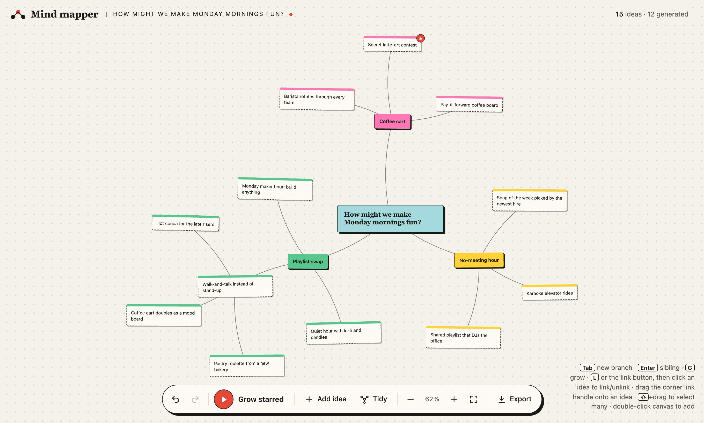
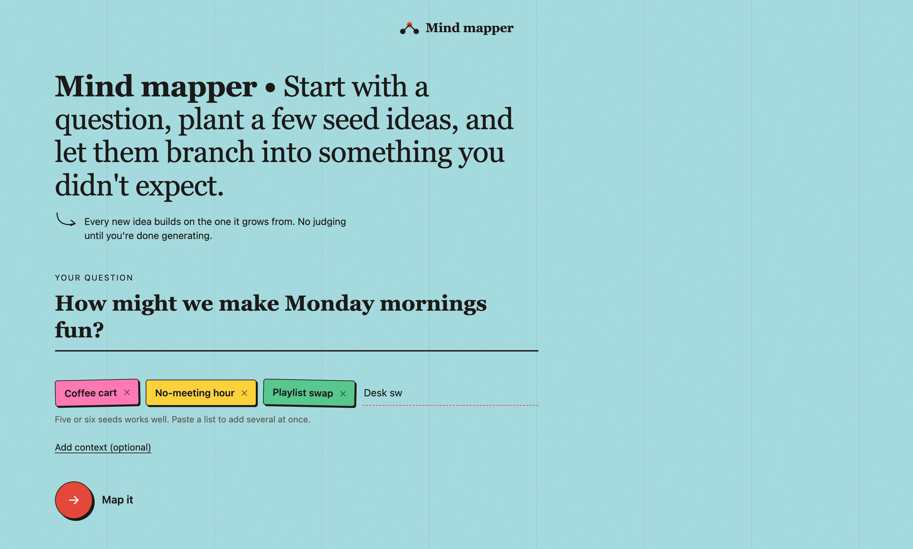
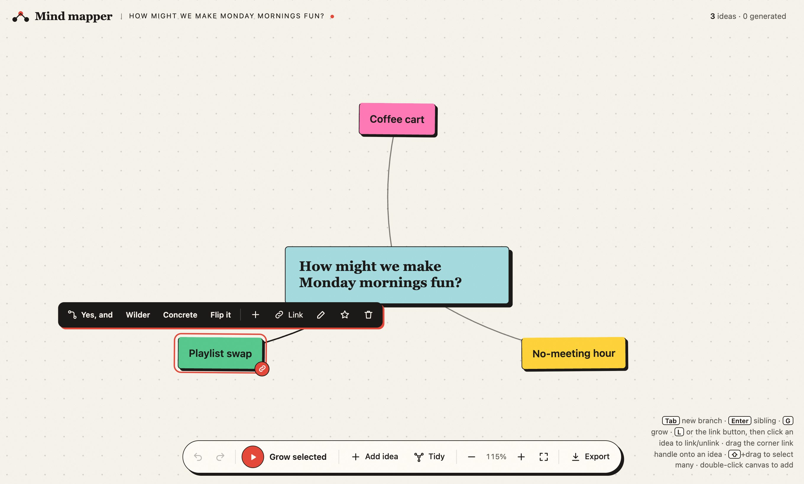
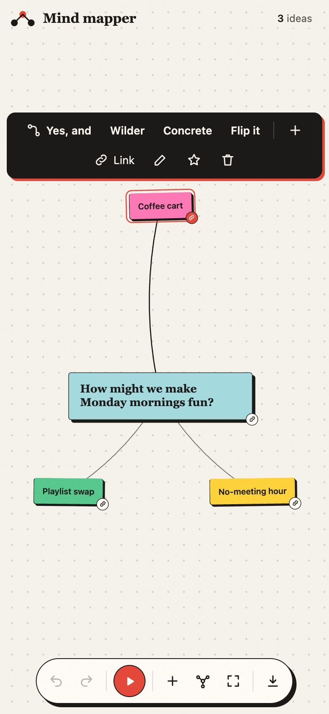

<div align="center">

# Mind Mapper

**Ask a question. Plant a few seeds. Watch them branch into ideas you didn't expect.**

A brainstorming canvas for claude.ai. Every idea can grow with Claude, plus a `/mind-map` skill that builds you a fresh map from one line in Claude Code.




</div>

## One line in, a whole map out

```
/mind-map How might we make Monday mornings fun? | coffee cart; no-meeting hour; playlist swap
```

Claude Code publishes a private map on claude.ai with your question in the middle and each seed as its own coloured branch. From there, you click and it grows.

| 1. Plant your seeds | 2. Get a map | 3. Take it anywhere |
|:---:|:---:|:---:|
|  |  |  |

<sub>The ideas in these screenshots are examples written for the docs. In the real app they come from Claude.</sub>

## Install the skill

You need [Claude Code](https://claude.com/claude-code).

```bash
git clone https://github.com/Vishruth-Sham/mind-map.git
mkdir -p ~/.claude/skills
ln -s "$PWD/mind-map/skill/mind-map" ~/.claude/skills/mind-map
```

Start a new Claude Code session and type `/mind-map …`. Because the skill is linked rather than copied, a `git pull` in the repo keeps it up to date. To copy it instead, run `cp -R mind-map/skill/mind-map ~/.claude/skills/`. To install it for one project only, put it in that project's `.claude/skills/`.

If you give fewer than 3 seeds, Claude tops up to 6 and marks which ones it added.

## What you can do on the map

- **Grow with Claude:** select an idea and pick **Yes, and**, **Wilder**, **Concrete** or **Flip it**. Select several ideas and **Combine** them into hybrids.
- **Keep growing:** one button keeps expanding the map, breadth-first. It focuses on your selection, then on starred ideas, then on everything, and stops at 220 ideas.
- **Link anything:** press `L` (or **Link**) and click another idea. Drag the corner handle onto an idea, or onto empty space to spawn a new one. Click a line to unlink it.
- **Arrange it:** drag, shift-drag to select many, pan, pinch or ⌘-scroll to zoom, and **Tidy** for an automatic layout.
- **Never lose anything:** undo/redo covers every change, including AI growth. Maps save themselves in the browser, and you can export or import an outline or a map file.
- **Works on phones:** it supports touch and two-finger pinch zoom.

### Keyboard

| Key | Action |
|---|---|
| `Tab` / `Enter` | new child / new sibling |
| `F2`, `E`, double-click | edit (`Enter` saves, `Esc` cancels) |
| `G` | grow the selected idea |
| `L` | link mode |
| `S` | star / unstar |
| `Delete` | delete the selection or the selected link |
| `⌘Z` / `⌘⇧Z` | undo / redo |
| `⌘A`, `Esc` | select all / clear |

## How it works

```
app/
  index.html   ~15-line page: just the seed block and two tags
  app.js       the whole app (UI, layout, AI, storage)
  app.css      styles
skill/mind-map/
  SKILL.md     instructions Claude follows for /mind-map
  app.js, app.css   bundled copies the skill publishes
```

For each map, the skill copies the bundled `app.js` and `app.css` into a fresh folder with one shell command and writes a tiny `index.html` whose seed block holds `{"id","q","ctx","seeds"}`. It then publishes all three as a new artifact with the `sample` capability. Claude only writes a few lines instead of the 60 KB app, so a new map takes seconds. The `id` gives each map its own saved state.

The page asks Claude for ideas through `await window.claude.use('sample')`. Outside claude.ai, that capability isn't available: the grow controls turn off, the top bar says "generation off", and everything else still works. You can open `app/index.html` straight from disk to try it.

## Develop

```bash
python3 -m venv .venv && .venv/bin/pip install -r requirements.txt
CHROME="/Applications/Google Chrome.app/Contents/MacOS/Google Chrome" .venv/bin/pytest   # ~3 min
.venv/bin/python tests/screenshots.py      # regenerate docs/screenshots/
```

The tests drive the real page in Chrome with Playwright, mock Claude, and fail on any console error. On Linux, `CHROME` defaults to `/usr/bin/google-chrome`. Add `-m "not slow"` to skip the 220-idea stress test.

After changing `app/app.js` or `app/app.css`, refresh the skill's copies (a test reminds you):

```bash
cp app/app.js app/app.css skill/mind-map/
```

## License

[MIT](LICENSE)
